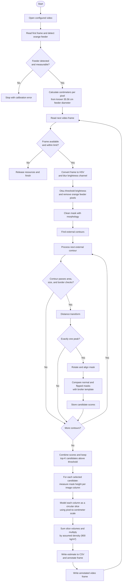

# Broiler Weight Estimation

> Forked from [AminNasiri63/BroilerWeightEstimation](https://github.com/AminNasiri63/BroilerWeightEstimation)

A production-oriented computer vision pipeline for estimating broiler chicken weight from video streams.
The system is designed for real-world poultry houses, emphasizing robustness, interpretability, and low computational cost.

Unlike deep-learning–heavy solutions, this project focuses on classical CV and geometric modeling, making it suitable for edge deployment, rapid prototyping, and environments with limited labeled data.

---

## Demo Video

https://github.com/user-attachments/assets/fe745700-ba96-4303-a332-41783033921b

---

## Why This Project Matters

- Enables non-contact weight monitoring in poultry farms.
- Reduces reliance on manual weighing.
- Designed for continuous, camera-based operation.
- Prioritizes explainability and engineering simplicity.
- Relevant Domains: AgTech & Precision Livestock · Edge / Applied Computer Vision.
---

## Features

- **End-to-End Video Pipeline**: Frame ingestion, ROI handling, segmentation, object validation, and weight estimation.
- **Classical, Learning-Free Segmentation**: Otsu thresholding of frame brightness, orange-feeder suppression, and morphological refinement.
- **Robust Object Selection**: Overlap rejection, boundary-touching instance removal, confidence scoring, and configurable Top-K candidate selection.
- **Pose-Normalized, Density-Aware Weight Estimation**: Orientation normalization + geometry-based volume computation, converted to weight using configurable broiler density (default: 900 kg/m³).
- **Structured Outputs**: CSV logging and annotated video output for debugging and offline analysis.
- **Modular Architecture**: Strategy and Factory patterns enabling extensibility and future DL integration.

---

## Project Structure

```
├── src
    ├── main execution.py          # Main entry point
    ├── VideoProcessorPipeline.py  # Core video processing pipeline
    ├── CameraLoader.py           # Camera configuration loader
    ├── SegmentationStrategy.py   # Segmentation implementations (Classical/Deep Learning)
    ├── ObjectFilterStrategy.py   # Object filtering and scoring logic
    ├── AreaCalculatorStrategy.py # Volume/weight calculation strategies
    ├── OutputWriters.py          # Output formatters (CSV)
    ├── Factories.py              # Factory classes for strategy creation
    ├── VideoIOClass.py           # Video input/output utilities
    ├── cameras_config.json       # Camera configuration file
    ├── broiler_template.png      # Template mask for broiler matching
    └── cam1.mp4                  # Sample video file
├── requirements.txt
└── README.md
```
---

## Installation

### Prerequisites

- Python 3.7+
- OpenCV 4.x
- NumPy

### Dependencies

```bash
pip install opencv-python numpy
```
---

## Configuration

The system is configured via `cameras_config.json`. Each camera entry defines:

- `crop`: Region of interest coordinates (x1, y1, x2, y2).
- `feeder`: Feeder area coordinates (for calibration).
- `pixel_to_cm`: Pixel-to-centimeter calibration factor.

Example configuration:

```json
{
  "cameras": {
    "cam1": {
      "crop": {"x1": 1900, "y1": 590, "x2": 3180, "y2": 1475},
      "feeder": {"x1": 1700, "y1": 700, "x2": 2250, "y2": 1100},
      "pixel_to_cm": 0.09
    }
  }
}
```
### Camera Calibration

- Accurate weight estimation requires pixel-to-real-world calibration. The current implementation detects the orange feeder in the video's first frame, measures its diameter in pixels, and uses the known feeder diameter (35.56 cm) to calculate centimeters per pixel.
- Feeder detection uses an HSV color range and morphological cleanup. Calibration raises an error if it cannot read the frame, find the feeder, or measure a sufficiently large feeder.

---

## Method Overview
The entry point calibrates the video from its first frame, then processes each frame independently. It creates a binary foreground mask, selects likely single-broiler contours, and estimates each selected bird's mass from calibrated circular slices through its mask. The diagram shows the implemented classical-segmentation path:



Volume estimation approximates each occupied image column as a cylinder slice: the mask's vertical span gives the slice diameter, and the calibrated pixel scale gives its dimensions in centimeters. Summing slice volumes and multiplying by the assumed broiler density produces the estimated mass in kilograms.


---

## Usage

1. Configure camera parameters in `cameras_config.json`.
2. Place input video files in the project directory.
3. (Optional) Adjust the Top-K candidate selection via the `top_k` parameter in the object filtering stage.
4. Update the video path in `main_execution.py` if needed.
5. Run the main script:

```bash
python "main execution.py"
```

The system processes the input video and saves an annotated output video along with a camera-specific CSV file named `<camera_id>_results.csv`.

### Output Format

The CSV output contains the following columns:

| Field        | Description |
|-------------|-------------|
| `camera_id` | Camera identifier |
| `frame_idx` | Frame number |
| `label`     | Object label (default: `"broiler"`) |
| `score`     | Combined confidence score |
| `volume`    | Estimated weight (kg) |
| `crop_region` | Bounding box coordinates `(x, y, w, h)` |

### Validate Weight Estimates

#### FlockLabel export and notebook

Install the pipeline and notebook dependencies, start Jupyter, and open
`src/validation_walkthrough.ipynb`:

```bash
python -m pip install -r requirements.txt jupyter
jupyter notebook
```

Set `EXPORT_DIR` in the first code cell to your export and run all cells.
Relative export paths are resolved from the repository root. If Jupyter was
started outside the repository, also set `REPO_ROOT` in that cell to the
absolute path of the repository folder (containing `src/run_eval.py`). The
notebook displays a sample frame, calibration, segmentation mask, filtering and
weight estimates, then processes every clip, reports validation metrics and
generates comparison videos. The videos show ground-truth boxes in green and
estimated boxes in red, including unmatched boxes. The first labeled clip is
embedded in the notebook; all comparisons are saved under
`<export>/results/comparisons/`. Some browsers may not support OpenCV's MP4
codec; open the saved video locally if necessary.

The expected export structure is:

```text
export/
├── test_videos/
│   ├── metadata.csv    # video_name
│   └── <video files listed in metadata>
└── ground_truth/
    ├── events.csv      # video_name, optional pixel_to_cm
    └── gt_boxes.csv    # video_name, frame_idx, x, y, w, h, weight_kg, event_id
```

Boxes use pixel `(x, y, width, height)` coordinates. The pipeline numbers
frames starting at 1; set `GT_FRAME_OFFSET = 1` for zero-based ground-truth
frame numbers, or leave it at 0 for one-based numbers. Video names must have
unique stems. `events.csv` can supply a positive `pixel_to_cm` per video;
otherwise calibration requires a detectable orange feeder in the first frame.
The runner reports calibration failures and exits unsuccessfully if any clip
was skipped. Existing result files are overwritten.

The same processing and evaluation can be run without Jupyter:

```bash
python src/run_eval.py /path/to/export
python src/evaluate_against_gt.py /path/to/export/ground_truth/gt_boxes.csv \
  --results-dir /path/to/export/results --out /path/to/export/results/evaluation \
  --gt-frame-offset 0
```

The evaluator greedily matches boxes by IoU on the same video and frame.
Estimates on frames without ground-truth labels are counted as unmatched, not
necessarily confirmed false positives. Event weight metrics use the median
of matched scale readings and the median estimate. Fit any suggested density
on separate calibration events and report accuracy on held-out events.

#### CSV weight validation

To compare estimates with measured weights, add an `actual_weight_kg` column to
the results CSV, with one measured weight in kilograms on each corresponding
row. The pipeline's estimated weights are in the `volume` column. Then run:

```bash
python src/weight_validation.py results/cam1_results.csv
```

The script reports mean absolute error (MAE), root mean squared error (RMSE),
mean bias (estimate minus actual), and mean absolute percentage error (MAPE).
Rows with zero actual weight are excluded from MAPE. For different column
names, use `--actual-column` and `--estimated-column`.

---

## Known Tradeoffs
**These are deliberate design choices aimed at reliability, transparency, and low deployment cost.**

- **Simplified Body Model:** Weight estimation is based on a cylindrical body assumption to ensure computational efficiency and interpretability.
- **Lighting Sensitivity:** Classical segmentation performs best under controlled illumination, which is a common constraint in commercial poultry houses.
- **Manual Calibration:** Pixel-to-centimeter calibration is currently configured on a per-camera basis to maintain measurement accuracy.
- **Template Dependency:** Shape-based validation relies on orientation-consistent templates, prioritizing precision over recall.

---

## Practical Notes

- Continuous per-frame estimation is often unnecessary; sampling frames and top-ranked broilers within a fixed time window can reduce computation without sacrificing monitoring quality.

---

## Roadmap

- Integration of deep learning models for improved segmentation.
- Posture-aware frame selection to improve volume-based weight estimation accuracy.
- Multi-species support with configurable templates.
- Web interface for configuration and monitoring.
- Statistical analysis and reporting features.
---

## License
MIT License.

---

## Contributing
Contributions are welcome! Please feel free to submit a Pull Request.
